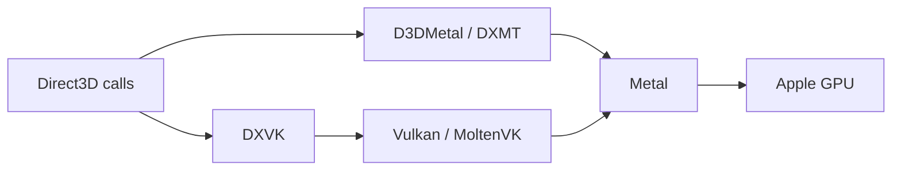

# ExeRunner

**A native macOS launcher for Windows applications and games on Apple Silicon.**

ExeRunner brings setup, a program library, launcher recipes, graphics selection and
compatibility diagnostics into one SwiftUI/AppKit application. It integrates a custom-built
Wine runtime with existing graphics translators and targeted compatibility fixes.

**Status:** private alpha, version 0.3. Primarily validated on an M2 Pro Mac.
The interface is available in English and Russian. Compatibility depends on the application.

## Screenshots

These are native UI exports of the local alpha built on **14/10/2026**. They show the
application catalog and settings, with English selected, without a personal game library.
The Windows-component manager is shown below.

### Application catalog


### Game and display settings


## What it does

The committed source provides:

- **A native program library:** launchers, Windows programs and games, with optional
  shortcuts in macOS Applications.
- **Steam integration:** discovers installed games across Steam library folders, launches
  them through the Windows client and provides a separate Stop action for each game.
- **Launcher recipes:** component setup, environment variables and graphics overrides in
  separate Wine bottles (Windows environments).
- **Compatibility profiles:** per-game graphics, Windows components and environment
  recommendations, including an attributed database imported from Whisky.
- **Diagnostics:** Wine and Unreal crash-log classification, troubleshooting checks, and
  support reports with user names and known secret patterns redacted.
- **Audio and media setup:** per-bottle audio configuration and a test sound, fonts,
  Discord status integration, and Media Foundation/GStreamer video decoding.

### Compatibility and runtime features

The alpha includes the following work, validated through regression checks, self-authored
Windows controls and selected real gameplay.

| Area | Implemented | Validation boundary |
| --- | --- | --- |
| Graphics | Explicit D3DMetal, DXMT, DXVK, Wine OpenGL and Wine Vulkan choices; Auto selection with a visible reason | Auto follows profiles and available components; it does not benchmark applications |
| Game Boost | macOS Game Mode policy during game sessions, restoration after the final game exits, and an independent monitor | Requires Apple's installed `gamepolicyctl`; no guaranteed FPS gain |
| Startup | A scoped Wine/Rosetta execution-breakpoint adapter | One tested Far Cry Primal executable revision; not a general protected-game fix |
| Audio | Preservation of center-channel dialogue when a six-channel stream reaches stereo output | Confirmed in Far Cry Primal dialogue; unrelated streams retain their previous behavior |
| Retina and fullscreen | Physical display modes, fullscreen presentation and cursor confinement with release on app switching | Fullscreen, camera turns and Cmd-Tab accepted in Far Cry Primal on the built-in display |
| Native resolution | Current-screen policy with backup of supported game display settings | Far Cry Primal adapter only; arbitrary games and multi-monitor switching need separate validation |
| Isolated launch | Experimental copied-bottle launch with restricted file-content access and blocked IP networking | Eligible standalone applications only; not a virtual machine or a malware guarantee |

## General Windows components

Open **… → Windows components…** on a library card to manage Visual C++, .NET Framework,
.NET/Windows Desktop runtimes through version 10, DirectX helper libraries, fonts and system
libraries. Components are shared within the selected bottle and downloaded/cache-reused
on demand. A failed batch keeps its successfully installed packages.

Ordinary standalone programs can prepare standard dependencies automatically from EXE imports
and runtimeconfig metadata. Wine Mono remains the default for compatible managed programs;
native .NET Framework is an explicit choice. Static inspection does not replace runtime
error diagnostics. See [general runtime behavior and tests](docs/general-runtime.md).


## How it works

ExeRunner manages setup, bottles, launch settings and process lifecycle. **Rosetta 2 handles
x86/x64 CPU instruction translation; Wine supplies Windows API compatibility.** Graphics
translation is a separate path:



The runtime is built from Wine 11.16 with CodeWeavers' CrossOver 26.3 changes. D3DMetal handles
DirectX 11/12; the alpha adds DXMT 0.80 for DirectX 10/11. DXVK/MoltenVK is used for
compatible Direct3D applications and launcher browser helpers. A helper can use DXVK while
the game it starts uses D3DMetal. The compatibility module configures overrides per executable.

Wine and Rosetta are upstream technologies; ExeRunner's work is the native product, runtime
integration, launch policy, diagnostics and scoped compatibility repairs.

## Recorded launcher compatibility

These are the recorded checks from **10/10/2026**, not guarantees for every launcher update
or game available in a store.

| Launcher | Recorded status |
| --- | --- |
| Steam | Tested: installation, library discovery, game launch and per-game Stop |
| EA app, Epic Games Launcher, Ubisoft Connect | Install and display their sign-in page; sign-in and games are not yet validated |
| Rockstar Games Launcher | Installer and initial startup checked; sign-in and games require further validation |
| Battle.net | Disabled in the catalog: sign-in browser crashes |
| GOG Galaxy | Disabled in the catalog: Qt 6 web view remains empty with the tested graphics paths |

A compatibility database entry is a recommendation, not evidence that this project tested
that game. Anti-cheat, drivers, store login flows and individual game versions can prevent
an application from working.

## Add a Windows application or game

1. Keep the complete application folder in a permanent location. If it came in a ZIP,
   extract all files together, including DLLs and data directories.
2. In the library, choose **Add program** and select the main `.exe` or `.msi` installer.
3. For a portable application, choose **Run as is**. For an installer, choose
   **This is an installer**, complete setup, then select the installed program's executable.
4. Give the item a name and add it to the library. Keep a portable application's folder
   in place after adding it.

Importing a program does not scan or certify it. Ordinary Wine applications can access Mac
files and networking. Use software from sources you trust.

## Build from source

The application targets **macOS 15 or later on Apple Silicon**. Building the full runtime
requires Xcode command-line tools, Rosetta, x86_64 Homebrew in `/usr/local` for Wine's linked
libraries, and arm64 Homebrew for the native build tools, MinGW-w64 and `cabextract`.
Pinned upstream versions and build stages are recorded in `scripts/build-engine.sh`.

```sh
# Build the runtime and its portable copy.
scripts/build-engine.sh all

# Package the native application and create a disk image.
scripts/build-app.sh
scripts/make-dmg.sh

# Check the committed compatibility database, core behavior and localization.
tests/cxcompatdb-test.sh
tests/core-test.sh
tests/l10n-test.sh
```

The app is produced at `build/app.noindex/ExeRunner.app`; the disk image is
`build/ExeRunner-<version>.dmg`. Run `scripts/build-engine.sh portable` again when you need
to regenerate the portable copy after changing runtime components.

D3DMetal is imported from Apple's
[Game Porting Toolkit download](https://developer.apple.com/download/all/?q=Game%20Porting%20Toolkit)
through the application. Its code is not stored in this repository. Packaging can omit it
with `scripts/build-app.sh --without-d3dmetal`; see [CREDITS.md](CREDITS.md) for provenance
and the associated notices.

`recipes/*.recipe` describe launcher installers, executables, environment variables,
per-program graphics/DLL overrides and catalog text. English UI strings are maintained in
`app/Sources/ExeRunner/Core/English.swift`; `tools/l10n-check.py` checks translation coverage.

The 0.3 disk image includes the current runtime and compatibility work. Validation on a clean
or second Mac remains pending.

## Next milestones

- Verify a clean installation of the current distribution build on another Mac.
- Expand dated application/game compatibility checks, including longer gameplay sessions.
- Validate external-display and multi-monitor transitions and add safe native-display adapters.
- Extend general printing, serial/USB and MIDI support with independent acceptance controls.

## License and attribution

ExeRunner's application code is **GPL-3.0-or-later**. See [LICENSE](LICENSE) and
[CREDITS.md](CREDITS.md) for upstream work, component licenses and icon provenance.
DXMT is an MIT-licensed upstream project: [3Shain/dxmt](https://github.com/3Shain/dxmt).

ExeRunner is not affiliated with Apple, Microsoft, Valve or CodeWeavers.
