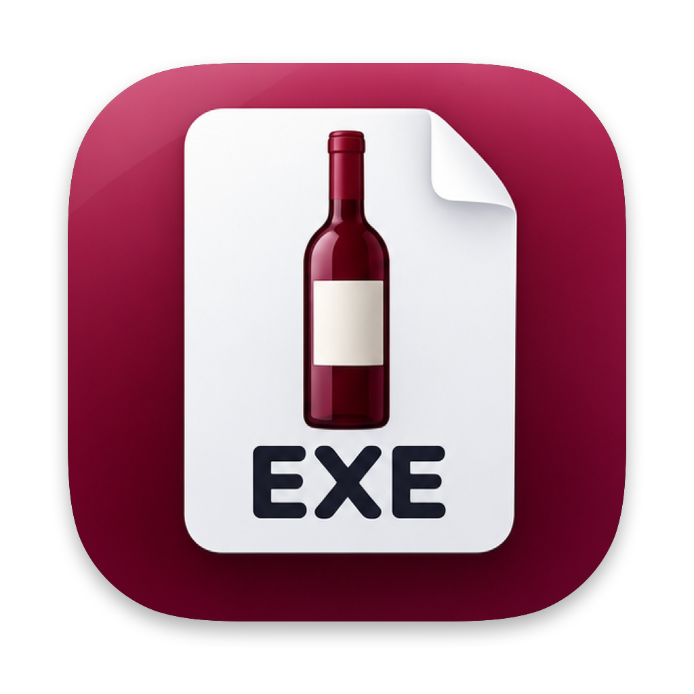
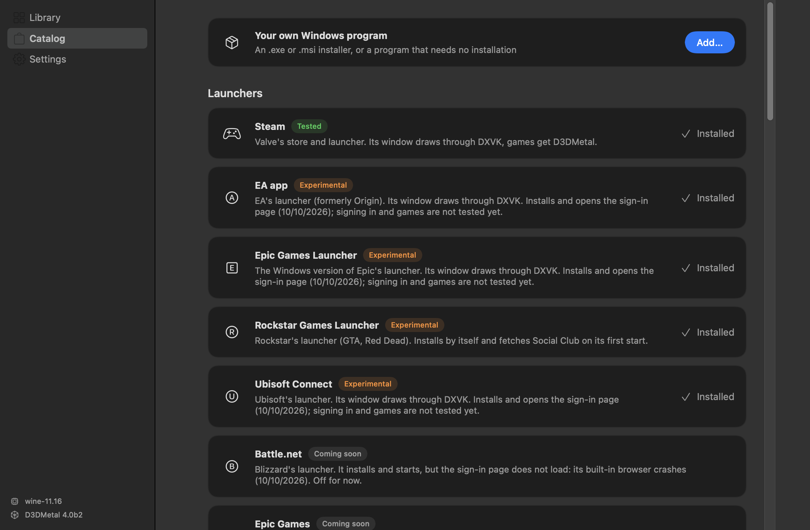
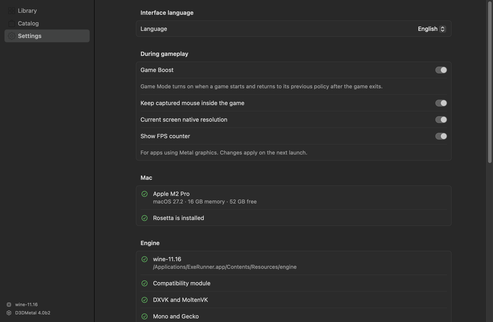
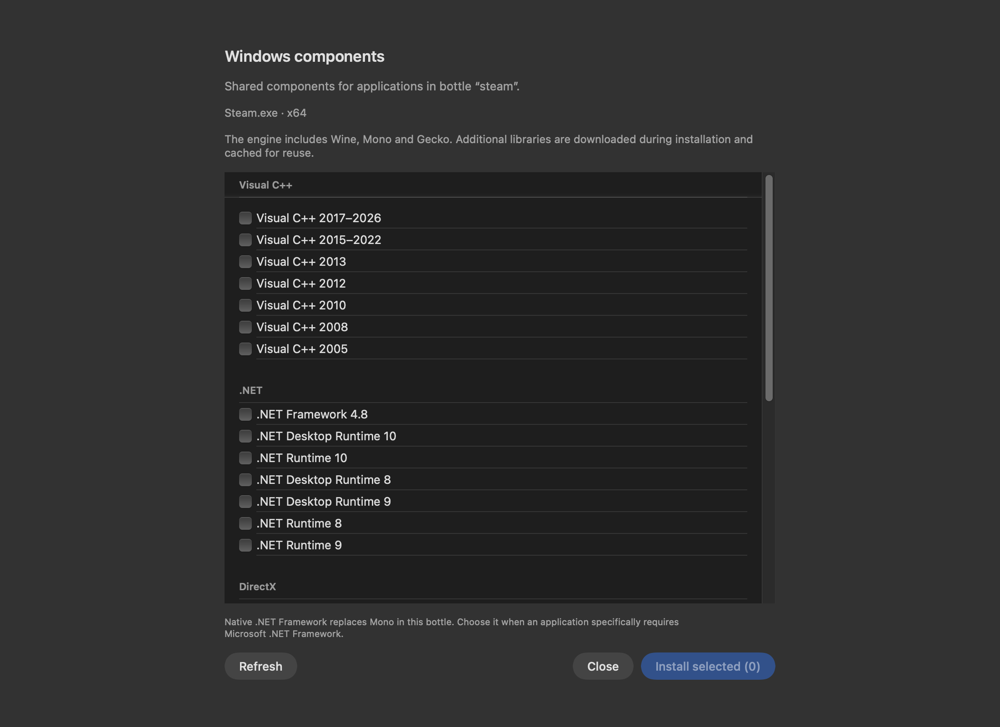
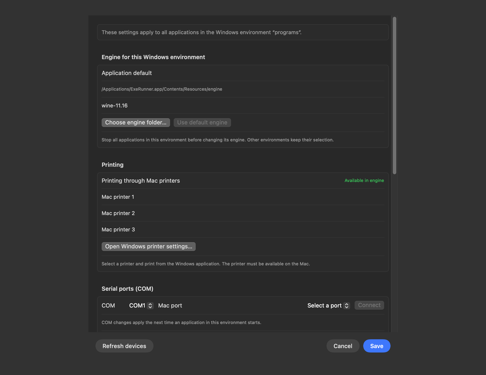

# ExeRunner

**A native macOS launcher for Windows applications and games on Apple Silicon.**

ExeRunner brings setup, a program library, launcher recipes, graphics selection and
compatibility diagnostics into one SwiftUI/AppKit application. It integrates a custom-built
Wine runtime with existing graphics translators and targeted compatibility fixes.

**Status:** early alpha, version 0.6.1. Primarily validated on an M2 Pro Mac.
The interface is available in English and Russian. The app executable includes arm64 and x86_64;
Intel hardware acceptance is still pending. Compatibility depends on the application.

## Install the alpha

For Apple Silicon and **macOS 15 or later**. Download the DMG and matching checksums from
[Releases](https://github.com/mmd-art/exerunner/releases), then read
[installation and first-open instructions](docs/INSTALL.md). This alpha is not Apple-notarized.
DXMT and DXVK/MoltenVK are bundled; Apple D3DMetal is an optional separate import. GPTK 4 beta is excluded because a linked library requires macOS 26.4.
The package starts with an empty personal library and includes no games, accounts or saves.
See [0.6.1 changes and limits](docs/RELEASE-0.6.1.md). Release downloads and source are available without collaborator access.

Already installed a Windows program? Use **Add → Already installed**, select its environment,
then search for its EXE. Reinstallation is not required.

From 0.6.0, **Settings → Updates → Check for updates…** downloads verified updates from
GitHub and offers installation/restart when Windows programs have closed. Install this
updater-enabled version manually once. See [update signing and release workflow](docs/updates.md).

## Screenshots

These are native UI exports of the local alpha built on **14/10/2026**. They show the
application catalog and settings, with English selected, without a personal game library.
The Windows-component manager is shown below. The environment/device panel was added on **15/10/2026**;
its native export anonymizes configured printer names.

### Application catalog



### Game and display settings



## What it does

The committed source provides:

- **A native program library:** launchers, Windows programs and games, with optional
  shortcuts in macOS Applications.
- **Steam integration:** discovers installed games across Steam library folders, launches
  them through the Windows client and provides a separate Stop action for each game.
- **Launcher recipes:** component setup, environment variables and graphics overrides in
  separate Wine bottles (Windows environments).
- **Compatibility profiles:** per-game graphics, Windows components and environment
  recommendations, including an attributed database imported from Whisky.
- **Diagnostics:** Wine and Unreal crash-log classification, troubleshooting checks, and
  support reports with user names and known secret patterns redacted.
- **Audio and media setup:** per-bottle audio configuration and a test sound, fonts,
  Discord status integration, and Media Foundation/GStreamer video decoding.

### Compatibility and runtime features

The alpha includes the following work, validated through regression checks, self-authored
Windows controls and selected real gameplay.

| Area | Implemented | Validation boundary |
| --- | --- | --- |
| Graphics | Explicit D3DMetal, DXMT, DXVK, Wine OpenGL, Wine Vulkan and experimental vkd3d choices; Auto selection with a visible reason | Auto follows profiles and available components; it does not benchmark applications |
| Game Boost | macOS Game Mode policy during game sessions, restoration after the final game exits, and an independent monitor | Requires Apple's installed `gamepolicyctl`; no guaranteed FPS gain |
| Startup | A scoped Wine/Rosetta execution-breakpoint adapter | One tested Far Cry Primal executable revision; not a general protected-game fix |
| Audio | Preservation of center-channel dialogue when a six-channel stream reaches stereo output | Confirmed in Far Cry Primal dialogue; unrelated streams retain their previous behavior |
| Retina and fullscreen | Physical display modes, fullscreen presentation and cursor confinement with release on app switching | Fullscreen, camera turns and Cmd-Tab accepted in Far Cry Primal on the built-in display |
| Native resolution | Current-screen policy with backup of supported game display settings | Far Cry Primal adapter only; arbitrary games and multi-monitor switching need separate validation |
| Environment engines | Default or a separate Wine engine per bottle, used for installation, launch, diagnostics and Stop | Changing a busy environment is refused; a missing explicit engine does not silently fall back |
| Printing | CUPS-backed Mac printers exposed to Windows printing APIs | Printer discovery and GDI print-to-file passed; no physical paper job was sent |
| Serial devices | Persistent COM1–COM255 mappings, connection status and managed removal | Bidirectional PTY and baud/state controls passed through the actual app preparation path; physical USB serial acceptance pending |
| Controllers | Native HID or SDL-based Xbox/XInput mapping per environment, with restoration of previous policy | Bluetooth DualSense enumerated in WinMM and XInput; button/stick input recorded through XInput |
| MIDI and OpenCL | Native CoreMIDI and OpenCL API bridges in the engine | WinMM message reached a virtual CoreMIDI destination; OpenCL platform enumeration passed |
| Isolated launch | Experimental copied-bottle launch with restricted file-content access and blocked IP networking | Eligible standalone applications only; not a virtual machine or a malware guarantee |

## Saves and session history

Select a save folder to create a manual verified snapshot; preview restoration and retain a
safety copy before replacing files. Backups are local and selected explicitly, not automatic cloud sync.
Local launch history, per-game playtime and recent applications observe actual game processes;
launcher uptime is excluded. Optional keep-awake lasts only while an observed game is active.
See [session behavior](docs/session-history.md) and the in-app save controls.

## General Windows components

Open **… → Windows components…** on a library card to manage Visual C++, .NET Framework,
.NET/Windows Desktop runtimes through version 10, DirectX helper libraries, fonts and system
libraries. Components are shared within the selected bottle and downloaded/cache-reused
on demand. A failed batch keeps its successfully installed packages.

Ordinary standalone programs can prepare standard dependencies automatically from EXE imports
and runtimeconfig metadata. Wine Mono remains the default for compatible managed programs;
native .NET Framework is an explicit choice. Static inspection does not replace runtime
error diagnostics. See [general runtime behavior and tests](docs/general-runtime.md).



## Engines, printing and devices

Open **… → Windows environment, engine and devices…** on a library card. These choices
are shared by all programs in that Windows environment.

- **Engine:** inherit the application default or select a folder containing `bin/wine`
  and `bin/wineserver`. External Wine engines can run ordinary GDI/OpenGL programs without
  a DXVK bundle. An explicitly selected renderer still needs its own runtime.
- **Printing:** use the Mac's configured printers from the Windows application's Print
  dialog. The panel also opens Windows printer settings.
- **COM:** choose a detected Mac serial device and a free COM number. Disconnected saved
  devices retain their mapping; connections configured outside ExeRunner are preserved.
- **Controllers:** choose **Xbox / XInput** for compatible gamepads in Xbox-input games,
  or **Native HID** for the original interface. **Automatic** restores the environment's
  previous controller policy. Changes apply on the next launch while the environment is idle.
- **USB, HID and MIDI:** the panel lists native devices and engine capabilities. A USB
  Ethernet adapter uses macOS networking; it does not require installing its Windows USB
  driver in Wine.

This is a general platform layer, not a guarantee for arbitrary Windows kernel drivers,
ASIO interfaces, protection dongles or every USB protocol. See
[device and engine behavior, controls and limits](docs/devices-and-engines.md).



## How it works

ExeRunner manages setup, bottles, launch settings and process lifecycle. **Rosetta 2 handles
x86/x64 CPU instruction translation on Apple Silicon; Intel hosts execute that code natively.
Wine supplies Windows API compatibility.** Graphics
translation is a separate path:


The runtime is built from Wine 11.16 with CodeWeavers' CrossOver 26.3 changes. D3DMetal handles
DirectX 11/12; the alpha adds DXMT 0.80 for DirectX 10/11. DXVK/MoltenVK is used for
compatible Direct3D applications and launcher browser helpers. A helper can use DXVK while
the game it starts uses D3DMetal. The compatibility module configures overrides per executable.

Wine and Rosetta are upstream technologies; ExeRunner's work is the native product, runtime
integration, launch policy, diagnostics and scoped compatibility repairs.

## Recorded launcher compatibility

These are the recorded checks from **10/10/2026**, not guarantees for every launcher update
or game available in a store.

| Launcher | Recorded status |
| --- | --- |
| Steam | Tested: installation, library discovery, game launch and per-game Stop |
| EA app, Epic Games Launcher, Ubisoft Connect | Install and display their sign-in page; sign-in and games are not yet validated |
| Rockstar Games Launcher | Installer and initial startup checked; sign-in and games require further validation |
| Battle.net | Disabled in the catalog: sign-in browser crashes |
| GOG Galaxy | Disabled in the catalog: Qt 6 web view remains empty with the tested graphics paths |

A compatibility database entry is a recommendation, not evidence that this project tested
that game. Anti-cheat, drivers, store login flows and individual game versions can prevent
an application from working.

## Add a Windows application or game

1. Keep the complete application folder in a permanent location. If it came in a ZIP,
   extract all files together, including DLLs and data directories.
2. In the library, choose **Add program** and select the main `.exe` or `.msi` installer.
3. For a portable application, choose **Run as is**. For an installer, choose
   **This is an installer**, complete setup, then select the installed program's executable.
4. Give the item a name and add it to the library. Keep a portable application's folder
   in place after adding it.

Importing a program does not scan or certify it. Ordinary Wine applications can access Mac
files and networking. Use software from sources you trust.

## Build from source

The application targets **macOS 15 or later on Apple Silicon**. Building the full runtime
requires Xcode command-line tools, Rosetta, x86_64 Homebrew in `/usr/local` for Wine's linked
libraries, and arm64 Homebrew for the native build tools, MinGW-w64 and `cabextract`.
Pinned upstream versions and build stages are recorded in `scripts/build-engine.sh`.

```sh
# Build the runtime and its portable copy.
scripts/build-engine.sh all

# Package the native application and create a disk image.
scripts/build-app.sh
scripts/make-dmg.sh

# Check the committed compatibility database, core behavior and localization.
tests/cxcompatdb-test.sh
tests/core-test.sh
tests/l10n-test.sh
```

The app is produced at `build/app.noindex/ExeRunner.app`; the disk image is
`build/ExeRunner-<version>.dmg`. Run `scripts/build-engine.sh portable` again when you need
to regenerate the portable copy after changing runtime components.

D3DMetal is imported from Apple's
[Game Porting Toolkit download](https://developer.apple.com/download/all/?q=Game%20Porting%20Toolkit)
through the application. Its code is not stored in this repository. Packaging can omit it
with `scripts/build-app.sh --without-d3dmetal`; see [CREDITS.md](CREDITS.md) for provenance
and the associated notices.

`recipes/*.recipe` describe launcher installers, executables, environment variables,
per-program graphics/DLL overrides and catalog text. English UI strings are maintained in
`app/Sources/ExeRunner/Core/English.swift`; `tools/l10n-check.py` checks translation coverage.

The 0.5.0 disk image includes the stable runtime, save snapshots, observed-game history/playtime and current-display launch work. Experimental D9MT is excluded. Validation on a clean
or second Mac remains pending.

## Next milestones

- Verify a clean installation of the current distribution build on another Mac.
- Expand dated application/game compatibility checks, including longer gameplay sessions.
- Validate external-display and multi-monitor transitions and add safe native-display adapters.
- Complete physical printer, USB/COM and MIDI acceptance beyond the local file/virtual-endpoint controls.
- Validate the universal build on Intel hardware and macOS configurations beyond this M2 Pro host.

## License and attribution

ExeRunner's application code is **GPL-3.0-or-later**. See [LICENSE](LICENSE) and
[CREDITS.md](CREDITS.md) for upstream work, component licenses and icon provenance.
DXMT is an MIT-licensed upstream project: [3Shain/dxmt](https://github.com/3Shain/dxmt).

ExeRunner is not affiliated with Apple, Microsoft, Valve or CodeWeavers.

## Build and test storage policy

Builds and committed test entrypoints run in marked workspaces under
`build/artifacts.noindex/jobs/`. Compiler/module caches and synthetic Wine prefixes
are removed after success or failure. Interrupted inactive work is collected at the
next invocation; work still used by a process is retained. No global `/tmp`, game,
user Documents or evidence-directory sweep is performed.

The policy keeps one previous verified app, one last checked engine and one current
installer. Small output tails have at most 20 receipts; authored test sources and
small documents are preserved by content hash instead of copying complete prefixes.
A single current build app is an output, not an additional rollback.

```sh
# Normal build with disposable compiler caches; does not quit the installed app.
bash script/build_and_run.sh --build-only
bash scripts/test.sh network-test.py --engine /path/to/engine
python3 -I tools/artifacts.py status
python3 -I tools/artifacts.py gc

# Native controls must pass before replacing the checked engine.
bash scripts/verify-engine.sh /path/to/candidate-engine
# Refuses a busy installed runtime; never quits games to update.
bash scripts/install-app.sh
bash scripts/make-dmg.sh
```

For a one-off experiment, use `python3 -I tools/artifacts.py run --label probe -- COMMAND`
and write temporary output to `$EXERUNNER_WORK_ROOT` or `$TMPDIR`. Do not create dated
app/engine backups or unmanaged test prefixes. Full `build-engine.sh all` and device
builds use disposable intermediate trees. Explicit `tools/configure/make` engine stages
retain their single incremental development tree until the developer finishes that workflow;
they do not create archival copies. Direct compiler commands outside these entrypoints
are outside the automatic policy.

An existing accepted rollback/engine/installer can be registered once with
`tools/artifacts.py seed --backup PATH --engine PATH --installer PATH`; registration
hashes and verifies the artifacts without copying them. An artifact modified outside
the policy, in use, or referenced by owner engine settings is not automatically deleted.

## Distribution verification

Release packaging rejects native binaries whose actual minimum macOS exceeds15,
missing x86_64 runtime slices, developer-machine links and unresolved bundled dependencies.
A newer Homebrew bottle may fail this gate even when the UI targets15.
`scripts/build-portable-floor.sh /path/to/portable-engine /path/to/pinned-wine-source`
builds a disposable native candidate and app without replacing the installed runtime.
`tests/fresh-profile-test.py --app /path/to/candidate.app --report /path/to/report`
checks actual onboarding, an empty library and native close in a verified disposable
Foundation home with owner-data write protection. These checks are not a second-Mac acceptance.

Private development diagnostics are kept outside Git. The public source and release
package contain no personal library, installed games, store sessions or saves.
